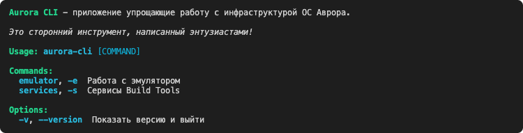

# Aurora CLI 4.0

> The application is under development!

Makes life easier for developers on Aurora OS.

- Windows
- macOS
- Linux



### Features

- Sign the package with a public key.
- Build the RPM package.
- Create sysroot (aarch64, armv7hl, x86_64).
- Generate MOC files for Qt.
- Validate rpm package.
- Install package to emulator.
- Run package on emulator.
- Docker-in-Docker support via `AURORA_CLI_CONTAINER_IN_CONTAINER` env variable.

### Install

Aurora SDK (BT): https://developer.auroraos.ru/downloads/sdk_bt

```shell
cargo install aurora-cli
```

### License

```
Copyright 2025 Vitaliy Zarubin

Licensed under the Apache License, Version 2.0 (the "License");
you may not use this file except in compliance with the License.
You may obtain a copy of the License at

    https://www.apache.org/licenses/LICENSE-2.0

Unless required by applicable law or agreed to in writing, software
distributed under the License is distributed on an "AS IS" BASIS,
WITHOUT WARRANTIES OR CONDITIONS OF ANY KIND, either express or implied.
See the License for the specific language governing permissions and
limitations under the License.
```
